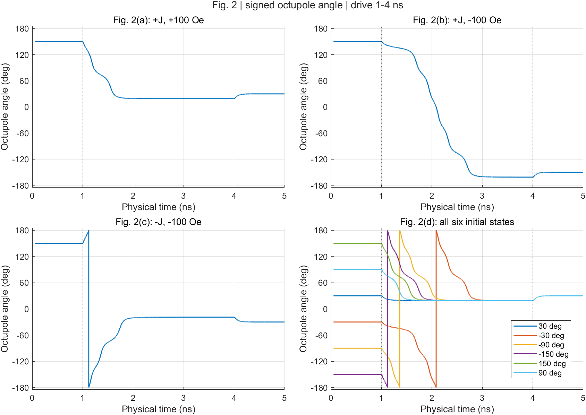
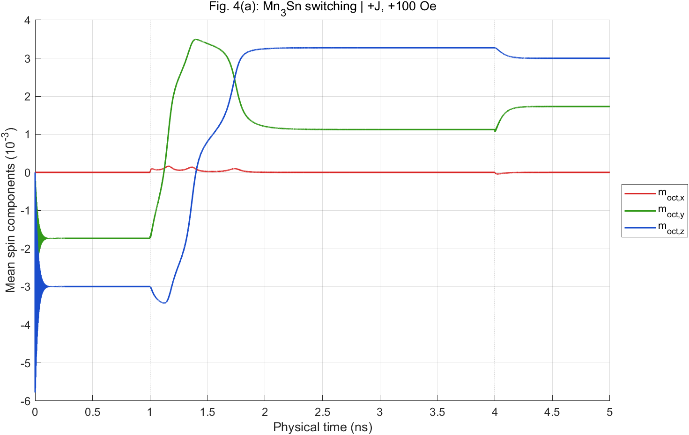
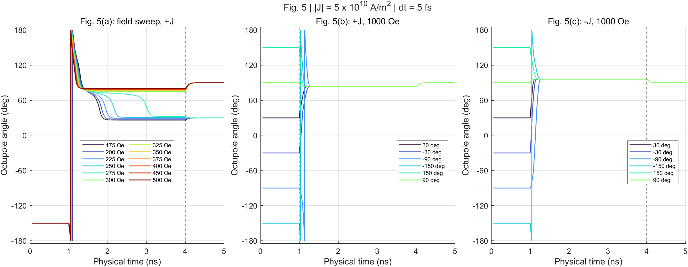

# Mn3Sn_3atoms

MATLAB macrospin code initially copied unchanged from the archived `code/fig5`
folder associated with [Physical Review B 109, 134433 (2024)](https://doi.org/10.1103/PhysRevB.109.134433).
The local source archive is `projects/published/2024.04-SOT Mn3Sn-zhengde-PRB/code/fig5`.
The fourth RK4 stage has since been corrected to use a full third-stage
increment. The original archive and initial-import checksum manifest are preserved.

The default configuration evolves three noncollinear fixed-length macrospins.
Six vectors are stored; `Hex_1=0` decouples the other triplet. This is a spatially
uniform model. `main.m` runs one parameter case rather than the complete Fig. 5 sweep.

## Source files

| File | Purpose |
| --- | --- |
| `main.m` | Entry script: parameters, initial conditions, pulses, solver call, and workspace save. |
| `conf_file.m` | Switches for torques, thermal noise, and other model options. |
| `constantfile.m` | Physical constants used by the scripts. |
| `rk4_4llg.m` | Time-stepping script, magnetization normalization, sampling, and text output. |
| `LLG_solver.m` | Magnetization time derivative and torque components. |
| `field_eta.m` | Effective fields and torque coefficients. |
| `pulsee.m`, `Hpulsee.m` | Current and applied-field pulse construction. |
| `theta_mtot.m` | Angle plot from the first triplet's mean magnetization in the loaded workspace. |
| `datproc.m`, `FFT_module.m` | Legacy post-processing helpers; see limitations below. |
| `PBSScript` | Archived cluster submission script. |
| `SOURCE_SHA256SUMS` | Immutable checksums of the 14 initially imported files. |

## Run

Run MATLAB from the directory containing `main.m` and the companion `.m` files.
For a new run, use a separate source copy to preserve existing results. From the
repository root in Bash/WSL:

```bash
run_dir=$(mktemp -d -t Mn3Sn_3atoms.XXXXXX)
cp -- ./*.m "$run_dir/"
cd "$run_dir"
matlab -batch "run('main.m')"
```

The outputs remain in that temporary directory; copy any results you need to a
permanent location. In the MATLAB desktop, open a separate copy of the source
folder, set it as the current folder, and run `main`.

The CPU path has previously been exercised with MATLAB R2024b. The default
configuration does not require a GPU; the archived `PBSScript` requests a GPU
queue and needs adaptation to a particular cluster. Thermal noise is disabled;
enabling it uses `normrnd` (Statistics and Machine Learning Toolbox).

Defaults in `main.m` include a 250 Oe field, current density $5\times10^{10}$ A/m$^2$,
damping 0.003, a 5 fs timestep, 1 ns initial relaxation, drive from 1 to 4 ns,
and relaxation until 5 ns. Parameters and switches are in `main.m` and `conf_file.m`.

See [Fig. 2 and Fig. 4(a) settings](FIG2_FIG4_SETTINGS.md) for panel-specific
parameters, initial-state mapping, plotting instructions, and verification limits.
See [RK4 correction verification](docs/rk4-verification.md) for checks of
Figures 2, 4(a), and 5, timestep convergence, and reproducible verification commands.

## Verified figure reproductions

These plots use the corrected RK4 integrator at a 5 fs timestep, with current
and field applied from 1 to 4 ns. Full trajectories were generated by the
deterministic C diagnostic and checked against short MATLAB trajectories;
the [verification report](docs/rk4-verification.md) records the numerical
checks and reproduction commands. The images are stored in `docs/figures/`
so they remain available without the local simulation outputs.

### Figure 2: current and field select the final state

The first three panels show switching for the published current and field
sign combinations. The fourth shows all six initial states
reaching +30 degrees under positive current and a +100 Oe field. Jumps at
+/-180 degrees are signed-angle wrapping, not instantaneous spin motion.



### Figure 4(a): Mn3Sn switching polarity

At positive current and +100 Oe, the mean z component switches from negative
to positive, crossing zero at approximately 1.399002 ns. The curves show
the three mean-spin components. The initial ringing comes
from the ideal 120-degree seed; the published plot shows a flat initial
segment. The ferromagnetic panel, Figure 4(b), is excluded.



### Figure 5: high-field final-state selection

The tested 175-275 Oe cases relax to +30 degrees, while the 300-500 Oe cases
relax to +90 degrees. At 1000 Oe, all six initial states reach +90 degrees
after pulse removal for either current sign. During the pulse, opposite
current signs produce different tilt angles, approximately 83.83 and
96.17 degrees; their relaxed final states coincide.



## Outputs

`main.m` overwrites `final.mat` with the workspace. `rk4_4llg.m` appends rows to
`result.txt`; the header/reset block in `main.m` is disabled. Preserve existing
results or run in a separate copy before launching. Both files are ignored by
Git and are absent from a fresh checkout; any archived copies are local only.

- With the default settings, `final.mat` contains the sampled `tt` time vector
  in seconds and the `mmx`, `mmy`, and `mmz` arrays. Their six columns follow the two triplets in order:
  `ma_init1`, `ma_init2`, `ma_init3`, `mb_init1`, `mb_init2`, `mb_init3`.
- `result.txt` has seven columns: time in picoseconds, followed by the x, y, z
  components of the first and second spins of the first triplet. It does not
  contain all six spins, and repeated runs append without a run separator.

To inspect a completed run in MATLAB, use `load('final.mat')` in its output
directory. `theta_mtot` uses the loaded workspace to produce an angle plot;
its angular-sign limitation is described below.

## Preservation and limitations

`SOURCE_SHA256SUMS` records all 14 original files, including the two local result
files. Ten MATLAB files and `PBSScript` retain their original bytes;
`rk4_4llg.m` has six intentional fourth-stage changes and retains its CRLF
line endings. From the repository root, check the unchanged distributed files:

```bash
rg '  (.*\.m|PBSScript)$' SOURCE_SHA256SUMS | rg -v '  rk4_4llg.m$' | sha256sum -c -
```

To check an untouched original archive containing both original result files:

```bash
sha256sum -c SOURCE_SHA256SUMS
```

The complete check requires the original results and original integrator;
the corrected integrator and newly generated outputs are not expected to
match their archived hashes. These checks verify preservation, not numerical
correctness. Focused deterministic verification tools are in `verification/`;
they do not constitute a general regression suite for every configuration.

Remaining known issues: `theta_mtot.m` discards angular sign, and saved time
labels differ from physical integration times by up to approximately 5 fs
at the default timestep. The verification uses signed angles and physical
times without changing those legacy output conventions. The original import
ran no simulation; subsequent checks are documented separately. Figure 4(b)'s
ferromagnetic model is not implemented here.

The legacy post-processing helpers need review before use: `datproc.m` contains
a machine-specific Windows path and expects a series of `final<number>.mat`
files, while `FFT_module.m` overwrites its arguments and references `mmx`, which
is not passed into the function. Neither helper is needed by `main.m`.

See [AGENTS.md](AGENTS.md) for repository maintenance rules and
[CHANGELOG.md](CHANGELOG.md) for recorded changes.

The source archive contained no license; no license has been added.
