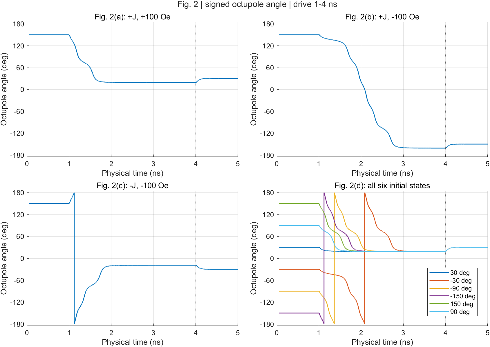
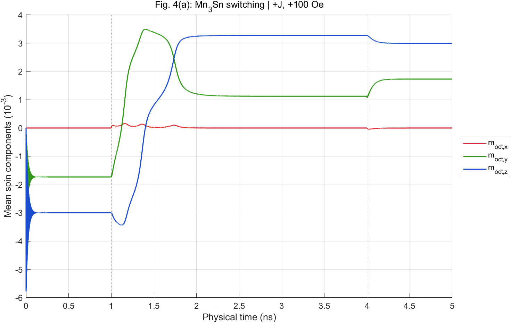
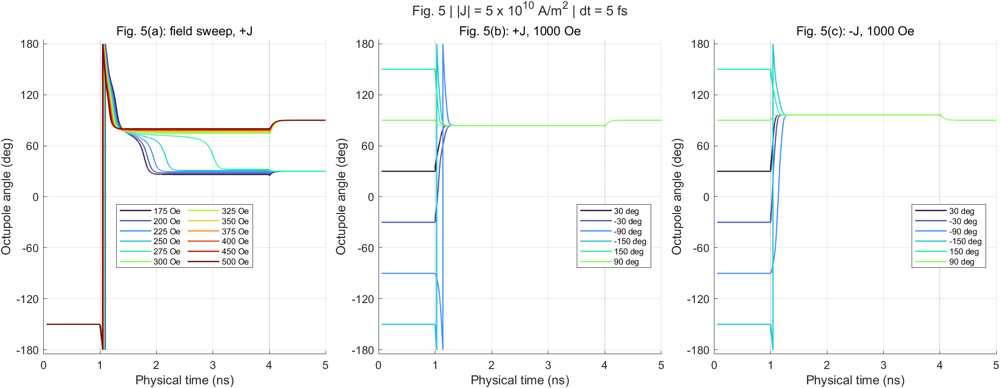

# Mn3Sn_3atoms

MATLAB macrospin code initially copied unchanged from the archived `code/fig5`
folder associated with [Physical Review B 109, 134433 (2024)](https://doi.org/10.1103/PhysRevB.109.134433).
The local source archive is `projects/published/2024.04-SOT Mn3Sn-zhengde-PRB/code/fig5`.
The fourth RK4 stage has since been corrected to use a full third-stage
increment. The original archive and initial-import checksum manifest are preserved.

The default configuration evolves three noncollinear fixed-length macrospins.
Six vectors are stored; `Hex_1=0` decouples the other triplet. This is a spatially
uniform model. `main.m` runs one parameter case rather than the complete Fig. 5 sweep.

## Source files

| File | Purpose |
| --- | --- |
| `main.m` | Default caller of the validated API; exposes legacy plotting aliases. |
| `mn3sn_default_config.m`, `mn3sn_validate_config.m` | Editable input defaults and pre-integration validation. |
| `mn3sn_run.m` | Private initialization, integration orchestration, fresh output directory and versioned save. |
| `mn3sn_sha256.m`, `mn3sn_resolve_path.m` | Source/file identity and destination resolution, including junctions. |
| `conf_file.m` | Switches for torques, thermal noise, and other model options. |
| `constantfile.m` | Physical constants used by the scripts. |
| `rk4_4llg.m` | Time-stepping script, normalization, sampling, and legacy text-row collection. |
| `LLG_solver.m` | Magnetization time derivative and torque components. |
| `field_eta.m` | Effective fields and torque coefficients. |
| `pulsee.m`, `Hpulsee.m` | Current and applied-field pulse construction. |
| `theta_mtot.m` | Angle plot from the first triplet's mean magnetization in the loaded workspace. |
| `datproc.m`, `FFT_module.m` | Legacy post-processing helpers; see limitations below. |
| `PBSScript` | Archived cluster submission script. |
| `SOURCE_SHA256SUMS` | Immutable checksums of the 14 initially imported files. |

## Run

Use MATLAB with Java enabled (tested: R2024b Update 1, Windows CPU). No GPU
or additional toolbox is needed for the supported deterministic path. Git is
optional for execution; its actual metadata probe outcome is saved. From MATLAB
in the repository root:

```matlab
main
```

This runs the original defaults: 250 Oe (`[0,0.0250,0]` T), current density
$5\times10^{10}$ A/m$^2$, damping 0.003, 5 fs timestep, 1 ns relaxation,
drive from 1 to 4 ns, and relaxation until 5 ns. A full default run takes several
minutes. `main` always recreates defaults; use the API below for overrides.
Outputs go to a new `.sisyphus/runs/<unique-id>/` directory printed on completion.

## Custom parameters

This complete example is a short illustrative pulse test, not a new validated
material parameter set. Run it with the repository on the MATLAB path:

```matlab
cfg = mn3sn_default_config();
cfg.alp = 0.003;             % dimensionless Gilbert damping
cfg.Hext = [0,0.0250,0];     % tesla (250 Oe)
cfg.jc_SOT = 5e10;           % A/m^2, signed current
cfg.runtime = 20e-12;        % seconds
cfg.starttime = 5e-12;
cfg.pulsewidth = 10e-12;
result = mn3sn_run(cfg);     % returns result and saves to a fresh directory
```

The factory is the complete editable-input list. Inputs are finite real doubles;
flags may also be logical. `initial_m` contains six unit rows in x/y/z order.
Time values are seconds, `tFL` is metres, `Ms_Fe/Ms_Gd` are emu/cm³, `Hex_2`
and `Hext` are tesla, and `hk_constant/DMI_constant` are joules. Timestep,
runtime, thickness and magnetizations must be positive; `savestep` is a positive
integer. Pulse segments and their rounded step counts must fit the runtime.
Constants remain in `constantfile.m`; pulse arrays and field coefficients are
derived by the runner. `conf_file.m` supplies factory switch defaults only.

Supported scope: dimensional deterministic RK4, DLT on/off, zero intertriplet
coupling, zero STT/FLT amplitudes, zero dipole/demagnetization, and no noise.
Unsupported switches, unknown/missing fields and invalid inputs raise errors
before integration. Keeping `SOT_FLT=1` with `jc_SOT2=0` preserves the default
zero FLT amplitude; it does not enable a tested finite-FLT model.

For a chosen location, call `mn3sn_run(cfg,fullfile(existing_parent,'new-run'))`.
The parent must exist and the destination must be new. Existing destinations and
paths into `benchmark/baseline/`, including resolved links/junctions, are rejected.
Move results needed long-term from ignored `.sisyphus` to your own data storage.

See [Fig. 2 and Fig. 4(a) settings](FIG2_FIG4_SETTINGS.md) for panel inputs and
signed plotting. [Benchmark commands](benchmark/README.md) cover ten quick cases,
one explicit full-default case, and focused tests. The
[CQ verification report](docs/code-quality-verification.md) records acceptance,
measurements and limitations; the [RK4 report](docs/rk4-verification.md) retains
the earlier figure/convergence evidence.

## Verified figure reproductions

These plots use the corrected RK4 integrator at a 5 fs timestep, with current
and field applied from 1 to 4 ns. Full trajectories were generated by the
deterministic C diagnostic and checked against short MATLAB trajectories;
the [verification report](docs/rk4-verification.md) records the numerical
checks and reproduction commands. The images are stored in `docs/figures/`
so they remain available without the local simulation outputs.

### Figure 2: current and field select the final state

The first three panels show switching for the published current and field
sign combinations. The fourth shows all six initial states
reaching +30 degrees under positive current and a +100 Oe field. Jumps at
+/-180 degrees are signed-angle wrapping, not instantaneous spin motion.



### Figure 4(a): Mn3Sn switching polarity

At positive current and +100 Oe, the mean z component switches from negative
to positive, crossing zero at approximately 1.399002 ns. The curves show
the three mean-spin components. The initial ringing comes
from the ideal 120-degree seed; the published plot shows a flat initial
segment. The ferromagnetic panel, Figure 4(b), is excluded.



### Figure 5: high-field final-state selection

The tested 175-275 Oe cases relax to +30 degrees, while the 300-500 Oe cases
relax to +90 degrees. At 1000 Oe, all six initial states reach +90 degrees
after pulse removal for either current sign. During the pulse, opposite
current signs produce different tilt angles, approximately 83.83 and
96.17 degrees; their relaxed final states coincide.



## Outputs

Each fresh run contains `final.mat` with **only `result`**, schema version 1,
and one `result.txt`. These replace the legacy full-workspace/append interface.
Existing archived files remain untouched.

- `config`, `effective_inputs`, `initial_m`, units and state order identify the
  actual calculation; `mmx/mmy/mmz` are sample-by-six arrays ordered
  `ma1,ma2,ma3,mb1,mb2,mb3`.
- `time_s` gives physical times. `legacy_tt` retains the original `linspace`
  labels. Solver metadata distinguishes requested, integrated and sampled ends.
- `provenance` contains UTC time, resolved source hashes, actual Git probes,
  MATLAB/toolboxes/platform, available CPU information and RNG states. No random
  draw occurs in the supported path.
- `result.txt` preserves the exact seven-column legacy formatting: old time label
  in ps and x/y/z of ma1 and ma2. At step `q` it records state `q+1` but label
  `t(q)`; physical time is `q*tstep`. It has its own sampling metadata and hash.

Load and plot without rebuilding a workspace:

```matlab
saved = load(fullfile(result.output_dir,'final.mat'),'result');
r = saved.result;
plot(r.time_s*1e9,mean(r.mmz(:,1:3),2));
xlabel('Time (ns)'); ylabel('Mean active-spin z');
```

`main` exposes `tt`, `mmx`, `mmy`, and `mmz` for existing workspace plots.
For the unchanged `theta_mtot` helper, also set
`totstep=result.effective_inputs.totstep; savestep=result.config.savestep;`.
Its unsigned-angle limitation remains; prefer the signed example in the figure
settings. Legacy helpers expecting full-workspace MAT variables require explicit
extraction from `result` and are not the maintained save interface.

## Preservation and limitations

`SOURCE_SHA256SUMS` records all 14 original files, including the two local result
files. Eight MATLAB files and `PBSScript` retain their original bytes.
`main.m`, `field_eta.m`, and `rk4_4llg.m` intentionally differ: the default
caller, explicit switches, RK4 correction and text-persistence separation.
All three retain their original CRLF line endings. From the repository root, check the unchanged distributed files:

```bash
rg '  (.*\.m|PBSScript)$' SOURCE_SHA256SUMS | rg -v '  (main|field_eta|rk4_4llg)\.m$' | sha256sum -c -
```

To check an untouched original archive containing both original result files:

```bash
sha256sum -c SOURCE_SHA256SUMS
```

The complete check requires the original results and original integrator;
the maintained sources and newly generated outputs are not expected to
match all archived hashes. These checks verify preservation, not numerical
correctness. Accepted regression artifacts are in `benchmark/baseline/`; the manifest records
explicit user acceptance and all 75 file hashes. Candidate runs never update
references. The suite covers the declared deterministic cases, not every configuration.

Remaining known issues: `theta_mtot.m` discards angular sign, and saved time
labels differ from physical integration times by up to approximately 5 fs
at the default timestep. The verification uses signed angles and physical
times without changing those legacy output conventions. The original import
ran no simulation; subsequent checks are documented separately. Figure 4(b)'s
ferromagnetic model is not implemented here.

The legacy post-processing helpers need review before use: `datproc.m` contains
a machine-specific Windows path and expects a series of `final<number>.mat`
files, while `FFT_module.m` overwrites its arguments and references `mmx`, which
is not passed into the function. Neither helper is needed by `main.m`.

See [AGENTS.md](AGENTS.md) for repository maintenance rules and
[CHANGELOG.md](CHANGELOG.md) for recorded changes.

The source archive contained no license; no license has been added.
